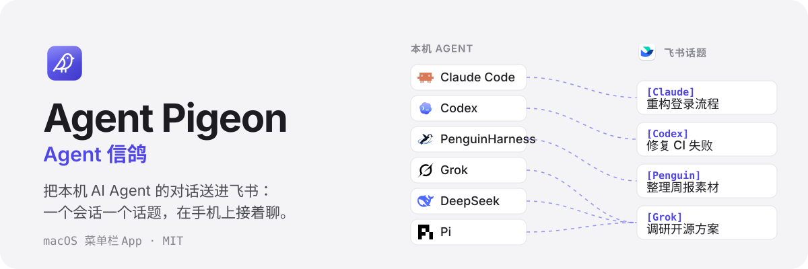
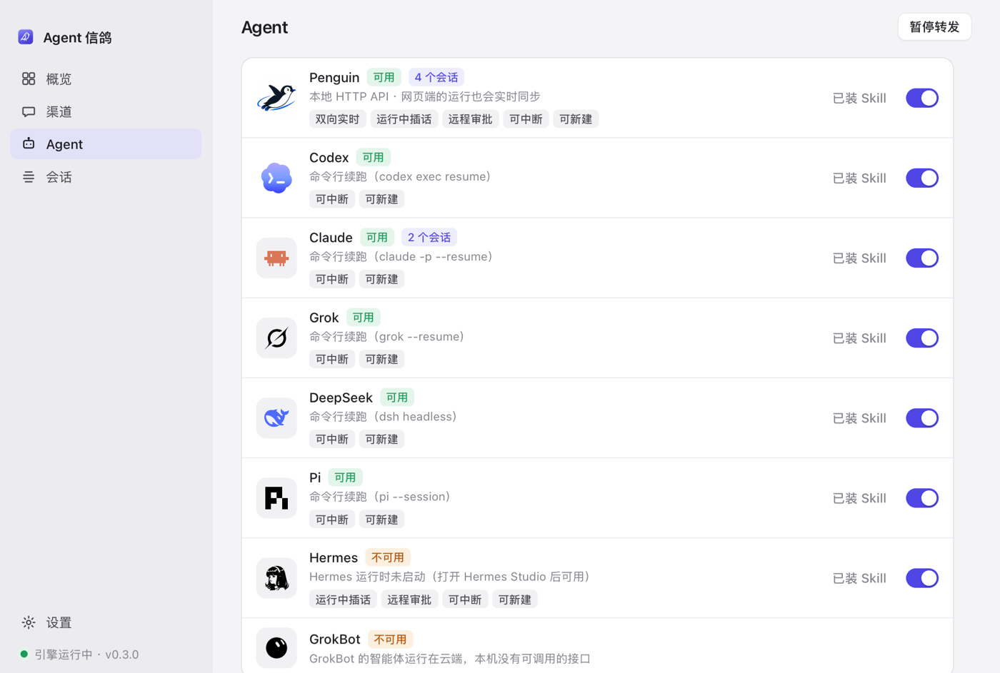
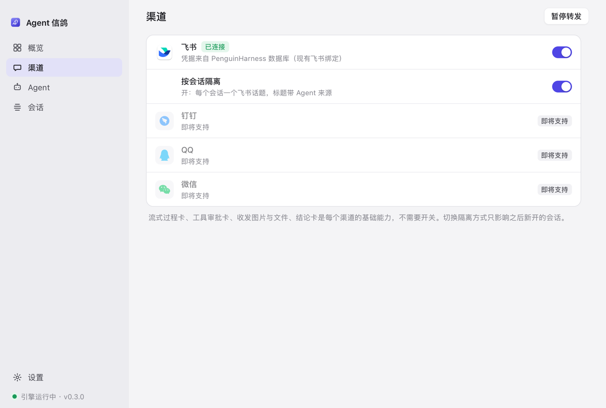

<p align="center">
  
</p>

<p align="center">
  <a href="LICENSE"></a>
  
  
  <a href="https://github.com/shrekcg/agent-pigeon/actions/workflows/ci.yml"></a>
</p>

Agent 信鸽（Agent Pigeon）是一个 macOS 菜单栏应用。它把你电脑上 AI Agent 的会话接到飞书：每个会话对应一个话题，话题里发的消息会送进那个会话继续跑，Agent 的执行过程和结论会实时回到话题里。离开电脑后，在手机上也能接着推进。

<p align="center">
  
</p>

## 适合什么场景

- **离开电脑后接着干**：在 Claude Code 里跑到一半的任务，出门前说一句「把这个对话接入飞书」，之后在手机的飞书话题里追问、补需求、看结果。
- **多个 Agent 同时干活**：Codex 修 CI，Claude 重构代码，Grok 查资料，每个会话都有自己的话题，标题自带来源，例如 `[Codex] 修复 CI 失败`，互不干扰。
- **在飞书里直接开新任务**：给机器人发 `/ht@claude〈写周报〉`，信鸽会在本机新建一个 Claude 会话，并为它开一个话题。
- **盯长任务、远程审批**：运行中的流式卡片会显示进度和工具步骤，可以随时点「停止」；遇到需要审批的工具调用（支持的 Agent），直接在卡片上点允许或拒绝。
- **收发文件**：把飞书里的图片、文件交给 Agent 处理；Agent 回复里写出的、本轮产出的文件会自动回传到话题。

## 话题里能看到什么

一个话题从上到下依次是：

1. **话题名片**：标题形如 `[Penguin] 验收·插话`，卡片里写着 Agent、会话 ID、模型和工作目录。
2. **你的消息**：例如「请依次执行三条 shell 命令，每条之间汇报进度」。
3. **执行过程卡**：运行中逐字刷新，显示状态行和工具步骤，带「停止」按钮；结束后折叠成「执行过程 · 3 步 · 完成 · 用时 39s」。
4. **插话回执**：运行中再发一句「最后总结时加上『收到插话』」，会收到「已插话：这条会并入当前运行」。
5. **结论卡**：本轮最后的回答单独成一张卡，例如「三条命令都已完成……收到插话。」

这是 2026-10-30 在飞书里实测的一轮 PenguinHarness 对话。如果这一轮产出了文件，文件会跟在结论卡后面回传。

## 支持的 Agent

| Agent | 接入方式 | Agent 自己窗口里的运行也同步 | 运行中插话 | 远程审批 |
| --- | --- | :---: | :---: | :---: |
|  Claude Code | `claude -p --resume`（stream-json） | | | |
|  Codex | `codex exec resume --json` | | | |
|  PenguinHarness | 本地 HTTP API + SSE | ✓ | ✓ | ✓ |
|  Grok | `grok --resume --output-format streaming-json` | | | |
|  DeepSeek Harness | `dsh --profile headless --json` | | | |
|  Pi | `pi -p --mode json --session` | | | |
|  Hermes | Hermes Studio 的 agent bridge | | ✓ | ✓ |

所有 Agent 都支持这些操作：从飞书新建会话、接入已有会话、流式过程卡、结论卡、发「停」中断、收发图片和文件、运行中排队。

命令行类 Agent（Claude Code、Codex、Grok、DeepSeek、Pi）的工作方式是：信鸽在后台让同一个会话续跑一轮。所以只有从飞书发起的轮次会显示在话题里，你在 Agent 自己窗口里打的字不会出现。不要在两边同时对同一个会话说话。

GrokBot 的智能体运行在云端，本机没有可调用的接口，所以暂时接不了。

## 渠道

| 渠道 | 状态 |
| --- | --- |
| 飞书 | 可用 |
| 钉钉、QQ、微信 | 即将支持 |

每个渠道只有一个设置项，「按会话隔离」：

- **开**（默认）：每个会话一个飞书话题，标题形如 `[Agent] 会话标题`。
- **关**：所有会话都进机器人的单聊，每条消息标注会话名。你回复哪条消息，就发给哪个会话；不回复任何消息时，发给当前会话，可以用 `/ht-use` 切换当前会话。

<p align="center">
  
</p>

## 安装

1. 从 [Releases](https://github.com/shrekcg/agent-pigeon/releases) 下载 `AgentPigeon-<版本>-arm64.dmg`，把「Agent 信鸽」拖进「应用程序」。（第一个版本还没发布，现在请先按下文「从源码构建」自行打包。）
2. 打开 App，菜单栏会出现一只信鸽。默认登录时启动，可以在「设置」里关掉。
3. 配置飞书应用：
   - 本机装过 PenguinHarness 并绑定过飞书机器人：信鸽会自动复用那份凭据，不用再配。
   - 没装：按 [docs/飞书应用配置.md](docs/飞书应用配置.md) 创建一个飞书自建应用，把 `appId`、`appSecret`、`chatId` 填进 `~/Library/Application Support/AgentPigeon/config.json`。
4. 在「Agent」页，给要用的 Agent 点「安装 Skill」。

> 没有用 Developer ID 签名的构建，第一次打开时 macOS 会拦下来。这时在「应用程序」里右键 App，选「打开」即可。

## 使用

**从 Agent 这一侧接入**：在已经装好 Skill 的 Agent 里说「把这个对话接入飞书」。Skill 会执行一行命令，飞书里随即出现对应的话题。

**从飞书这一侧操作**：给机器人发下面的指令。

| 指令 | 作用 |
| --- | --- |
| `/ht`、`/ht〈标题〉` | 用默认 Agent 新建会话并开话题 |
| `/ht@codex〈标题〉` | 用指定 Agent 新建会话（`@claude`、`@grok`、`@dsh`、`@pi`、`@penguin`） |
| `/ht@claude 最近`、`/ht@codex 〈ID前缀〉` | 接入已有会话 |
| `/ht-list@pi` | 列出某个 Agent 的会话 |
| `/ht-agents` | 查看本机各 Agent 是否可用 |
| `/ht-cn〈新名字〉` | 改话题标题 |
| `/ht-close` | 下线话题（原 Agent 会话不受影响） |
| `/ht-use〈ID前缀〉` | 「按会话隔离」关闭时，切换当前会话 |
| `/ht-help` | 指令帮助 |

在话题里直接说话就是对话：

- 发「停」：中断当前运行。
- `/pd 内容`：排到下一轮再执行。
- 运行中直接发消息：支持插话的 Agent 会把它并入当前运行，其他 Agent 会自动排队。

## 工作原理

```
渠道（src/channels）   飞书 · 钉钉/QQ/微信（规划中）
      ↕
中枢（src/hub）        绑定：渠道里的一个位置 ↔ 某个 Agent 的一个会话
      ↕
Agent（src/agents）    每个 Agent 一个适配器，统一输出同一套运行事件
```

| 部分 | 说明 |
| --- | --- |
| 外壳 `app/macos` | Swift 写的菜单栏 App，约 160KB，负责托管引擎进程、显示窗口、管理登录项 |
| 引擎 `src/` | JavaScript 写成，用 `bun build --compile` 编成一个二进制，不需要另装 Node |
| 界面 `app/web` | 纯 HTML/CSS/JS，用系统自带的 WebKit 显示，没有用 Electron |
| 数据 | `~/Library/Application Support/AgentPigeon`：配置、绑定、日志、附件 |

整个 App 约 58MB。加 Agent、加渠道的方法见 [docs/architecture.md](docs/architecture.md)。

## 安全

信鸽会让本机 Agent 执行来自飞书的指令。为了在手机上不卡在审批，Agent 默认以无人值守模式运行，可以读写文件、执行命令。

- 引擎只处理配置里那一个单聊的消息。
- 本地 API 只监听 `127.0.0.1`。
- 可以在 `config.json` 里按 Agent 收紧权限。

详见 [SECURITY.md](SECURITY.md)。

## 从源码构建

需要 macOS 13 及以上、Node.js 22.5 及以上、[Bun](https://bun.sh)、Swift 5.9 及以上。

```bash
git clone https://github.com/shrekcg/agent-pigeon.git
cd agent-pigeon
npm ci
npm test
scripts/build-app.sh
```

产物在 `dist/` 目录：`Agent 信鸽.app` 和 `AgentPigeon-<版本>-arm64.dmg`。要用 Developer ID 签名并公证，先设置环境变量再运行脚本：

```bash
SIGN_ID="Developer ID Application: 你的名字 (TEAMID)" NOTARY_PROFILE=notary scripts/build-app.sh
```

开发时不必打包：

```bash
npm run dev
```

然后用浏览器打开 <http://127.0.0.1:47821/>。

## 已知限制

- 目前只支持 Apple 芯片（arm64）的 Mac。Intel 版用 `ARCH=x64 scripts/build-app.sh` 应该能打出来，但还没有验证过。
- 命令行类 Agent 只同步从渠道发起的轮次，见上文「支持的 Agent」。
- Hermes 需要 Hermes Studio 在运行。
- 没装 PenguinHarness 时，飞书凭据要手动写进 `config.json`，App 里还没有填写凭据的界面。

## 参与

欢迎提 Issue 和 PR，尤其是接入新 Agent、新渠道的。开发说明见 [CONTRIBUTING.md](CONTRIBUTING.md)。

## 许可

[MIT](LICENSE)。各 Agent 和渠道的标志归各自所有者，来源见 [THIRD_PARTY_NOTICES.md](THIRD_PARTY_NOTICES.md)。
